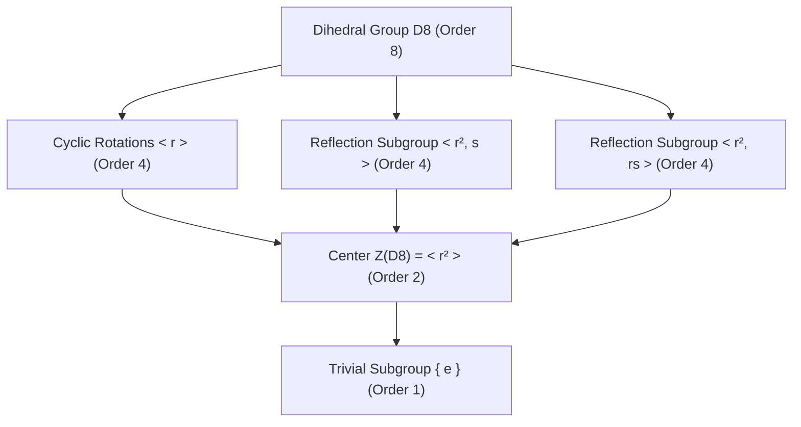
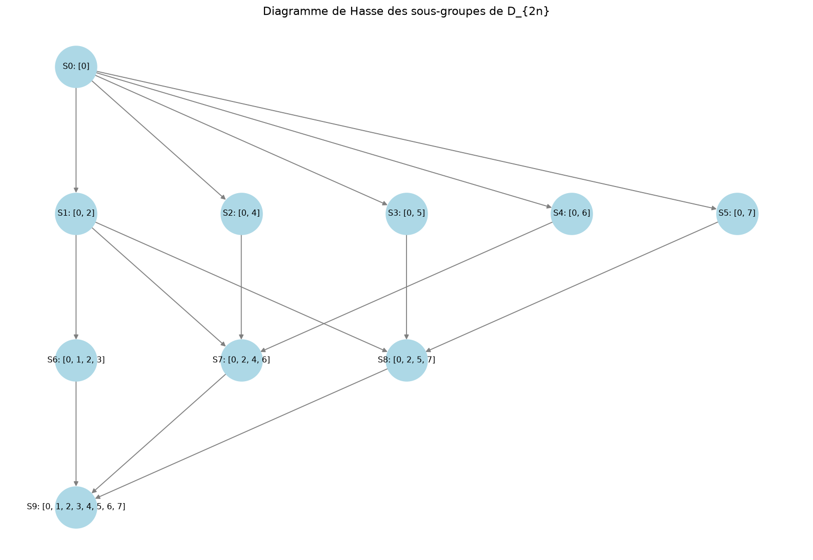
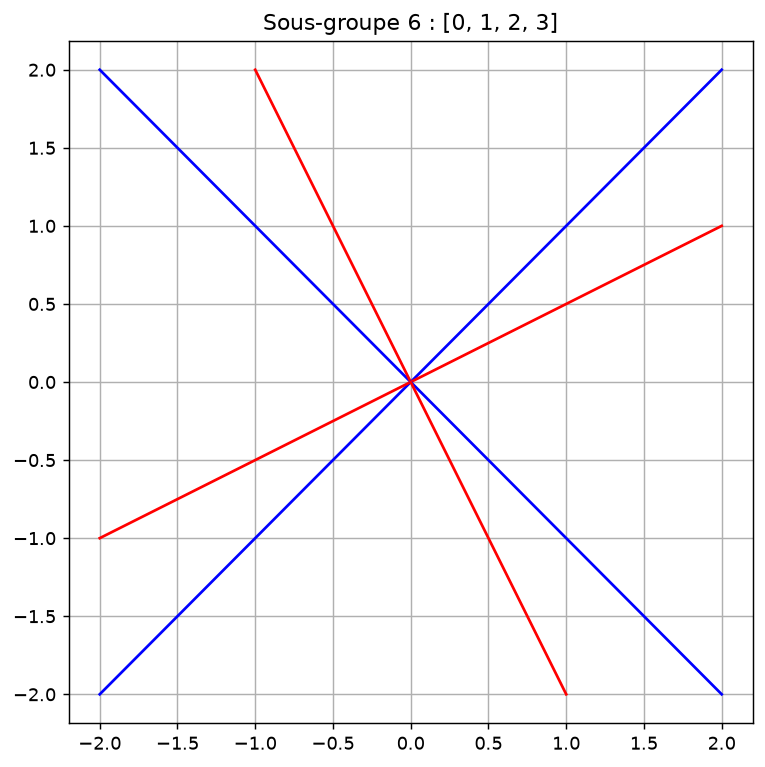
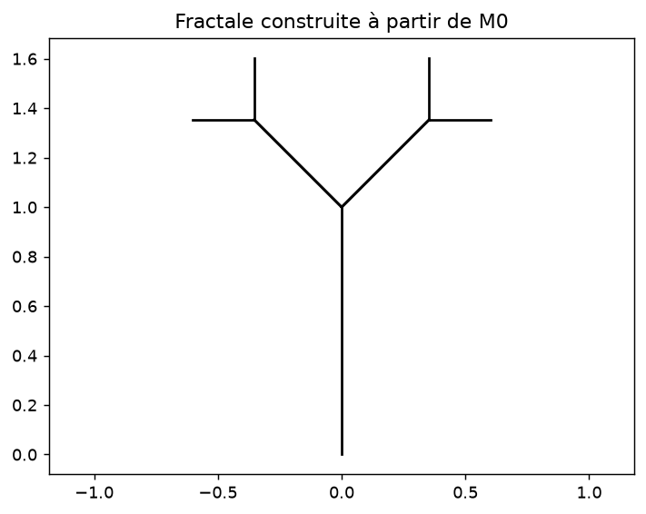
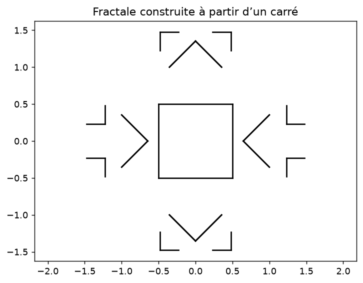
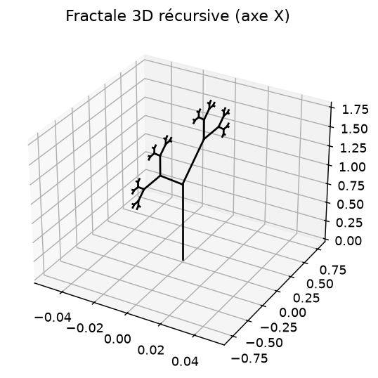
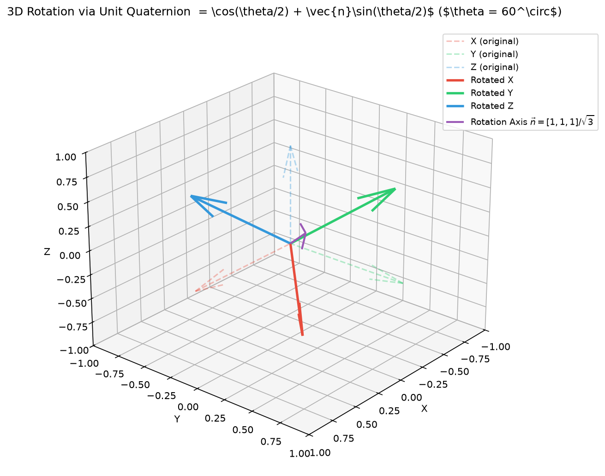

# Visual Mathematics — Computational Geometry, Group Theory & Quaternions

[](https://www.python.org/)
[](https://numpy.org/)
[](https://matplotlib.org/)
[](https://networkx.org/)
[](https://www.utbm.fr/)
[](#)
[](#)

> **Visual Mathematics & Computational Geometry Lab Assignments** developed in **Spring 2025** (Course MV55) as part of the Computer Science Engineering curriculum at **UTBM** (*Monde Virtuel / Virtual Worlds & 3D Computer Graphics* specialization).

---

## 📌 Overview

This repository explores fundamental mathematical structures underpinning 2D/3D computer graphics, computer vision, and scientific simulation. Rather than studying formulas purely on paper, each assignment implements algorithms from scratch and visualizes them programmatically:

1. **Group Theory & Symmetries (TP1):** Algebraic structure of dihedral groups $D_{2n}$, exhaustive subgroup lattice discovery, directed Hasse diagrams, and geometric symmetry actions.
2. **Affine & Projective Geometry — Iterative Fractals (TP2):** Matrix representations of homotheties, rotations, and translations in homogeneous coordinates; recursive 2D and 3D branching fractals via Iterative Function Systems (IFS).
3. **Hamiltonian Quaternions & Spatial Rotations (TP3):** Quaternion algebra $\mathbb{H}$, Rodrigues axis-angle representation, unit quaternion-to-matrix mapping, and gimbal-lock-free 3D spatial rotations in $SO(3)$.

---

## 📐 Part 1: Symmetries, Dihedral Groups & Hasse Lattices

Explores the symmetries of regular $n$-sided polygons using the **Dihedral Group** $D_{2n}$, generated by rotations $r$ of angle $2\pi/n$ and axial reflection $s$.



### Key Implementations
* **Group Composition & Cayley Table:** Constructed algebraic permutation tables in decimal and quaternary representations.
* **Subgroup Lattice & Hasse Diagram:** Algorithmic discovery of all subgroups of $D_{2n}$, computing direct inclusion relationships and visualizing the resulting partially ordered set (poset) with **NetworkX**.
* **Geometric Symmetry Motifs:** Applied subgroup operations $\sigma \in H$ to reference points, producing characteristic kaleidoscopic symmetry patterns.

<p align="center">
  
  
  <br><em>Left: Directed Hasse diagram showing subgroup inclusions of D8. Right: Symmetrical 2D geometric pattern generated by subgroup action.</em>
</p>

---

## 🌿 Part 2: Affine Geometry & Iterative Function Systems (IFS)

Studies recursive self-similarity in 2D and 3D projective space using affine transformation matrices in homogeneous coordinates:

$$\begin{pmatrix} x' \\ y' \\ 1 \end{pmatrix} = \begin{pmatrix} k \cos\theta & -k \sin\theta & t_x \\ k \sin\theta & k \cos\theta & t_y \\ 0 & 0 & 1 \end{pmatrix} \begin{pmatrix} x \\ y \\ 1 \end{pmatrix}$$

### Implementations
* **2D Branching Trees:** Composed successive contractions ($k = 0.5$, $\theta = \pm \pi/4$) and vertical translations to generate recursive tree structures.
* **Perimeter Snowflakes:** Applied IFS rules iteratively to the four edges of a unit square, creating fractal boundary curves.
* **3D Projective Tree:** Extended transformations to $4 \times 4$ projective matrices in $\mathbb{R}^3$, generating spatial branching structures.

<p align="center">
  
  
  
  <br><em>Left: 2D recursive branching tree. Center: Square perimeter fractal curve. Right: 3D projective fractal tree.</em>
</p>

---

## 🔄 Part 3: Hamiltonian Quaternions & 3D Spatial Rotations

Euler angles suffer from **gimbal lock** (loss of one degree of freedom when two rotation axes align). Unit quaternions provide an elegant, singularity-free double cover of the 3D rotation group $SO(3)$.

### Quaternion Formulation
A quaternion $q \in \mathbb{H}$ is defined as:
$$q = t + x\mathbf{i} + y\mathbf{j} + z\mathbf{k}, \quad \mathbf{i}^2 = \mathbf{j}^2 = \mathbf{k}^2 = \mathbf{i}\mathbf{j}\mathbf{k} = -1$$

A 3D point $p \in \mathbb{R}^3$ is rotated by angle $\theta$ around unit axis $\vec{n} = (n_x, n_y, n_z)$ via conjugation by the unit quaternion $q = \cos(\theta/2) + \vec{n}\sin(\theta/2)$:
$$p' = q \cdot p \cdot q^{-1}$$

<p align="center">
  
  <br><em>3D coordinate frame rotated by θ = 60° around spatial axis n = [1, 1, 1]/√3 using unit quaternion conjugation.</em>
</p>

### Key Implementations
* **Quaternion Arithmetic:** Pure NumPy implementations of Hamilton product, conjugation, Euclidean norm $\|q\|$, inverse $q^{-1}$, and polar decomposition.
* **Quaternion $\leftrightarrow$ $SO(3)$ Matrix Conversion:**
  * Forward conversion: Built the exact $3 \times 3$ direction cosine matrix from unit quaternion parameters.
  * Inverse conversion: Implemented the robust Shepperd/Shoemake algorithm using matrix trace $T = \text{Tr}(R)$ to avoid numerical instability near zero-trace orientations.
* **Properties Verified:** Numerical validation of associativity $(p \cdot q) \cdot r = p \cdot (q \cdot r)$ and rotation preservation over randomized spatial trials.

---

## 📁 Repository Structure

```text
├── TP1_Groupe_Diedral_et_Transformations.py    # Group theory, Cayley tables & Hasse lattices
├── TP1_Groupe_Diedral_et_Transformations.pdf   # Original assignment statement
├── TP2_Fractales_et_Transformations_Geometriques.py # Homogeneous 2D/3D affine geometry & IFS fractals
├── TP2_Fractales_et_Transformations_Geometriques.pdf# Original assignment statement
├── TP3_Quaternions_et_Rotations_Espace.py      # Quaternion arithmetic, SO(3) rotations & conversions
├── TP3_Quaternions_et_Rotations_Espace.pdf     # Original assignment statement
├── img/                                        # Generated visual outputs
│   ├── hasse_diagram_d8.png
│   ├── dihedral_motif_subgroup_7.png
│   ├── fractal_tree_2d.png
│   ├── fractal_square_snowflake.png
│   ├── fractal_tree_3d.png
│   └── quaternion_3d_rotation.png
├── requirements.txt
└── README.md
```

---

## 🛠️ Installation & Execution

```bash
# Clone the repository
git clone https://github.com/victorpiana/tps-python-maths-visuelles.git
cd tps-python-maths-visuelles

# Setup virtual environment
python -m venv .venv
source .venv/bin/activate
pip install -r requirements.txt
```

### Run Assignments
```bash
# Run TP1 — Symmetries & Hasse Diagram
python TP1_Groupe_Diedral_et_Transformations.py

# Run TP2 — 2D/3D IFS Fractals
python TP2_Fractales_et_Transformations_Geometriques.py

# Run TP3 — Quaternions & Rotations
python TP3_Quaternions_et_Rotations_Espace.py
```

---

## 👨‍💻 Author

**Victor Piana**
* Computer Science Engineering Student — *Monde Virtuel (Virtual Worlds & 3D Computer Graphics)* specialization
* **UTBM** (Université de Technologie de Belfort-Montbéliard) • Spring 2025 (Course MV55)
* LinkedIn: [linkedin.com/in/victor-piana-107230238](https://www.linkedin.com/in/victor-piana-107230238/)
* GitHub: [@victorpiana](https://github.com/victorpiana)
